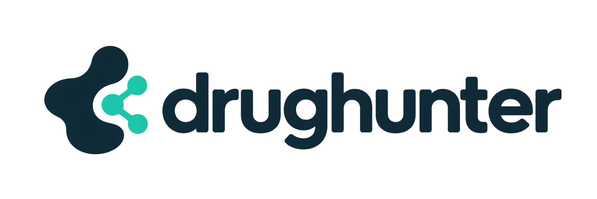

<p align="center">
  
</p>

# drughunter

[](https://github.com/sponsors/snsrap)

A structure-based drug discovery toolkit that makes AI models easy for scientists to use.

Find pockets in protein structures, score them against sites known from
experiment, prepare the structures they are found in, and generate binders for
them — from a browser viewer or from the command line.

One package, three parts:

| part | command | what it does | docs |
| --- | --- | --- | --- |
| **proteinviewer** | `proteinviewer` | the browser viewer and the local server behind it | [docs/proteinviewer.md](docs/proteinviewer.md) |
| **pocketbench** | `pocketbench` | pocket detection (fpocket, lacuna), superposition, apo/holo scoring | [docs/pocketbench.md](docs/pocketbench.md) |
| **quickprep** | `quickprep` | structure preparation: protonation, missing atoms and loops, refinement, provenance | [docs/quickprep.md](docs/quickprep.md) |

The viewer is only a GUI. Its server runs pocketbench and quickprep as
commands, in its own interpreter, and imports neither; it holds no science of
its own. pocketbench and quickprep do not need the viewer: each is a complete
command-line tool and Python library.

## Install

From PyPI:

```sh
pip install drughunter
```

This installs the Python tools and the viewer. The external detectors (fpocket,
lacuna, NEAT-POCKET) are separate; see below.

From a checkout, one environment holds all three. With pyenv:

```sh
pyenv virtualenv 3.11.14 drughunter
cd drughunter && pyenv local drughunter
pip install -e '.[test,lacuna]'     # lacuna is optional
```

Any virtual environment does (`python -m venv .venv`); Python 3.10 or newer.
This pulls in what quickprep needs (OpenMM, PDBFixer, PDB2PQR, PROPKA, gemmi,
numpy); the viewer's server and pocketbench need only the standard library.

### Optional and external tools

lacuna is an optional dependency: the `lacuna` extra above installs it into
the same environment. fpocket and NEAT-POCKET cannot come from
`pyproject.toml`: fpocket is a C program that is not on PyPI, and NEAT-POCKET
runs from a checkout of its own (its scripts, configuration and model weights)
with torch and PyTorch Geometric builds that must match the GPU. The server
looks for each tool at startup, prints what it found, and the page says what
is missing.

| tool | needed for | install | or point at it with |
| --- | --- | --- | --- |
| [fpocket](https://github.com/Discngine/fpocket) | **Find pockets** | a binary on `PATH`: `conda install -c conda-forge fpocket`, or build it from the repository | `FPOCKET_BIN` |
| [lacuna](https://github.com/mooreneural/lacuna) | the ensemble detector (optional) | the `lacuna` extra, or an environment of its own; for MD on a GPU under WSL2 see [docs/lacuna-integration.md](docs/lacuna-integration.md) | `LACUNA_BIN` |
| [NEAT-POCKET](https://github.com/molinfo-vienna/NEAT-POCKET) | **Generate binders** (optional) | its own environment with torch, per its README, plus its model weights | `NEAT_POCKET_DIR`, `NEAT_PYTHON` |

The checkout is stock upstream: drughunter's own `pocketgen/neat_pocket.py`
does the generation (pockets as residue selections, no bound ligand needed)
and is run by NEAT-POCKET's interpreter against that checkout.

The page loads 3Dmol.js and its fonts from CDNs, so the first load needs
network access.

## Run

```sh
proteinviewer            # serves http://127.0.0.1:8000/ and opens a browser
```

From a checkout, `./serve.py` is the same and `./start.sh` first stops a
viewer already on that port. Both run `python3`, which `pyenv local` above
makes the drughunter environment's.

`pocketbench` and `quickprep` work on their own:

```sh
pocketbench detect fpocket 1HSG.pdb --top 5
pocketbench score pockets.json apo.pdb holo.pdb LIG
quickprep 1HSG.pdb -o 1HSG_prep.pdb
```

## Releases

Feature branches start from `dev` and merge into `dev`. Every push to `dev`
runs the tests and, if they pass, releases the next minor version
(`v1.2.0` -> `v1.3.0`): the tag, a GitHub release, and the package on
[PyPI](https://pypi.org/project/drughunter/). `dev` is merged into `main` by
hand, then the merge commit is tagged by hand to release it, which builds and
publishes the Docker image to `ghcr.io/snsrap/drughunter`:

```
git tag v2.0.0 && git push origin v2.0.0
```

That is the only time the image is built.

```
docker run --rm -p 127.0.0.1:8000:8000 -v drughunter-data:/data ghcr.io/snsrap/drughunter
```

## Tests

```sh
python -m pytest     # all of it: the server, pocketbench, quickprep
npm test             # the page's pure modules, Node 18+
```

The server's tests use fake tools and run on the standard library alone
(`python -m unittest discover -s tests -t .`). quickprep's tests prepare real
structures with OpenMM; real fpocket is exercised when it is on `PATH`, real
lacuna with `PB_SLOW_TESTS=1`. The browser walkthrough is in
[docs/proteinviewer.md](docs/proteinviewer.md#tests).

## Style

Ruff lints and formats (`[tool.ruff]` in `pyproject.toml`). Install the hook once with
`pip install -e ".[dev]" && pre-commit install`; CI runs the same two checks.

## Layout

```
pyproject.toml     one distribution; its version is the git tag, which proteinviewer,
                     pocketbench and quickprep all report (tests/test_packaging.py)
serve.py start.sh  run the viewer from a checkout
proteinviewer/     the server, standard library only, and the page in app/
pocketbench/       detection, superposition, scoring; standard library only
quickprep/         preparation; OpenMM, PDBFixer, PDB2PQR, PROPKA, gemmi
tests/             the server's; tests/pocketbench, tests/quickprep, tests/js, tests/e2e
docs/              one page per part, the lacuna integration, apo/holo validation
```

pocketbench and quickprep were separate repositories until version 0.3.0;
their histories are merged into this one.

## Citation

If you use DrugHunter in published work, please cite it:

> snsrap. *DrugHunter* (version 0.3.0). https://github.com/snsrap/drughunter

Please also cite the tools you used; they are listed in
[THIRD_PARTY.md](THIRD_PARTY.md).

## Sponsor

DrugHunter is free and open source, and it is developed in the open. If it
helps your work, you can support it through
[GitHub Sponsors](https://github.com/sponsors/snsrap).

Sponsorship pays for two things:

- **Development.** Agentic coding sessions that build and maintain the
  platform.
- **Compute.** GPU time to train, benchmark, and deploy the machine-learning
  and deep-learning models behind ligand-based and structure-based drug design.

Sponsoring does not buy priority on issues or features, and the software stays
under the Apache License 2.0.

## License

Copyright 2026 snsrap. Licensed under the Apache License, Version 2.0; see
[LICENSE](LICENSE).
